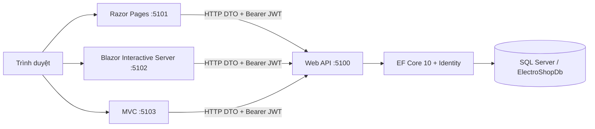

# Kiến trúc ElectroShop

RazorPage, BlazorWeb, MVC chỉ tham chiếu Shared và UiKit. API tham chiếu Shared. Tests tham chiếu API. Chỉ API có Entity Framework, connection string và nghiệp vụ SQL. Frontend không truy cập database. Shared chứa requests có Data Annotations, DTO kết quả và enum. UiKit là Razor Class Library chỉ chia sẻ static assets CSS, JavaScript nhỏ và ảnh SVG, không chia sẻ HTML giữa ba framework.

## Luồng đăng nhập

1. Popup gửi form HTTP POST kèm antiforgery đến server frontend hiện tại.
2. Server gọi `api/auth/login` hoặc `register`; Identity ở API kiểm tra/hash mật khẩu.
3. API cấp JWT có user id, role, security stamp, hạn 60 phút. Frontend giữ JWT trong store bộ nhớ server, khóa bằng session id ngẫu nhiên.
4. Cookie HttpOnly chỉ chứa danh tính và session id đã mã hóa bởi ASP.NET Core Data Protection; JWT không nằm trong browser storage.
5. Typed client tạo Authorization header trên từng request theo session người dùng; không đặt token dùng chung lên HttpClient mặc định.
6. API xác minh chữ ký/hạn JWT và kiểm tra tài khoản còn active, chưa lockout, security stamp chưa thay đổi. Thay role/khóa tài khoản thu hồi token cũ ngay.

Mỗi frontend có tên cookie riêng; các app dùng cùng hostname nhưng khác port sẽ không ghi đè phiên nhau. Đăng xuất xóa session/token của app hiện tại. Mất bộ nhớ khi restart khiến người dùng cần đăng nhập lại; đây là giới hạn được chấp nhận cho ứng dụng học tập một instance. Cookie dùng Secure khi HTTPS, SameSite Lax, HttpOnly. Với HTTP localhost cần cho phép cookie phát triển không Secure.

Blazor dùng AuthenticationStateProvider trong scoped service để lấy claims của circuit. HTTP endpoints thực hiện SignIn/SignOut rồi reload; không ghi cookie từ component event, không giữ HttpContext làm nguồn danh tính của circuit. Các thao tác interactive chạy qua SignalR circuit có xác thực; form HTTP dùng antiforgery.

## Luồng giỏ hàng và thanh toán

Giỏ SQL thuộc UserId lấy từ JWT, không lấy từ request body. Giá và tồn kho được kiểm tra tại API. Checkout snapshot dữ liệu tên/SKU/giá thành OrderItems; không giữ stock và không trừ kho lúc tạo đơn.

`CheckoutKey` ổn định cho một lần tạo đơn, unique theo UserId. Gửi lại key trả đơn cũ. `AttemptKey` ổn định cho một lần thanh toán, unique theo OrderId. Thất bại giữ giỏ/tồn kho; thử lại trên cùng order với AttemptKey mới. Thành công lặp trả payment thành công đã lưu.

Thanh toán dùng transaction Serializable: đọc đúng đơn của user, kiểm tra payment cũ, kiểm tra lại tồn kho/trạng thái sản phẩm, trừ kho, lưu Payment Success, cập nhật đơn, xóa số lượng đã mua khỏi giỏ rồi commit. SQL unique filtered index chỉ cho một payment Success/đơn. RowVersion bảo vệ cập nhật tồn kho và đơn trước thao tác admin đồng thời. Deadlock/concurrency trả409 để client gửi lại cùng key; không âm thầm báo thành công.

Giá snapshot của đơn đang chờ được giữ khi admin sửa giá; hệ thống demo không có thời hạn hết hiệu lực cho báo giá. Tiền là decimal(18,2), giao dịch sandbox không nhận số thẻ và không chuyển tiền thật.

## Quy tắc trạng thái đơn

- Pending + payment Success → Confirmed → Shipping → Completed.
- Pending chưa thanh toán thành công → Cancelled.
- Không hủy đơn đã thanh toán vì dự án không triển khai hoàn tiền/hoàn kho.
- Gửi lại cùng trạng thái không làm đổi kho.

Admin controller có `[Authorize(Roles="Admin")]`; ẩn link quản trị chỉ hỗ trợ trải nghiệm, không thay thế phân quyền API. Cập nhật quyền và kiểm tra quản trị viên cuối cùng nằm cùng transaction Serializable. Sản phẩm/danh mục xóa mềm; OrderItem lưu snapshot và quan hệ Restrict bảo toàn lịch sử.
