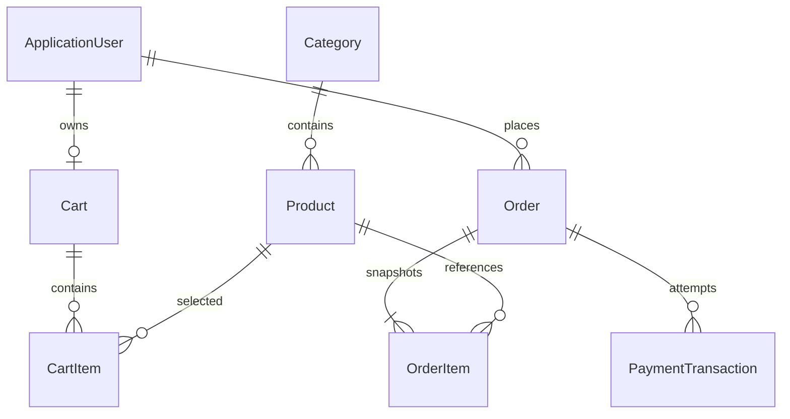

# Database SQL Server

Database duy nhất: **ElectroShopDb**, EF Core 10 Code First. Migration và model snapshot nằm `API/Data/Migrations`. API dùng SQL compatibility150 tương thích SQL Server2019 có sẵn trong `.devcontainer`. Không dùng SQLite hoặc EF InMemory.



| Entity | Vai trò và ràng buộc |
|---|---|
| ApplicationUser | Kế thừa IdentityUser, FullName, CreatedAt, IsActive. Email/PhoneNumber từ Identity. PasswordHash chỉ nằm backend. Role qua AspNetRoles/AspNetUserRoles. |
| Category | Name, Slug unique, Description, IsActive. Ẩn danh mục cũng ẩn sản phẩm khỏi catalog và không thể mua. |
| Product | SKU/Slug unique, Category FK Restrict, Name, Description, Price decimal(18,2), StockQuantity, ImageUrl, IsActive, CreatedAt/UpdatedAt, RowVersion SQL. |
| Cart | Một giỏ/user (unique UserId), CreatedAt/UpdatedAt. User FK Restrict. |
| CartItem | Unique CartId+ProductId, Quantity 1..999. Cascade chỉ từ giỏ đến items; product Restrict. |
| Order | OrderCode unique; UserId+CheckoutKey unique chống tạo đơn lặp; địa chỉ/người nhận, TotalAmount, trạng thái, thời gian, RowVersion. |
| OrderItem | ProductName/ProductSKU/UnitPrice là snapshot. LineTotal=UnitPrice*Quantity. Order/Product FK Restrict. |
| PaymentTransaction | TransactionCode unique; OrderId+AttemptKey unique; filtered unique OrderId WHERE Status=1 đảm bảo một lần thành công. Amount, Provider=Sandbox, Status, thời gian/thông báo lỗi. |

Các enum lưu số: OrderStatus Pending=0, Confirmed=1, Shipping=2, Completed=3, Cancelled=4; PaymentStatus Pending=0, Success=1, Failed=2. JSON API chuyển enum thành chuỗi dễ đọc.

Cấu hình tại `API/Data/Configurations/ShopConfiguration.cs`: check constraints giá/tồn không âm; số lượng dương; tổng dòng đúng phép nhân. Mọi trường tiền dùng decimal(18,2). Không cascade từ sản phẩm/user/đơn tới lịch sử thanh toán. SQL Server tự sinh RowVersion; admin gửi chuỗi base64 từ DTO khi sửa sản phẩm. Bản sửa cũ nhận409.

## Migrations và seed

```bash
set -a; source .env; set +a
dotnet tool restore
dotnet ef database update --project API --startup-project API
dotnet run --project API --no-launch-profile -- --seed-only
```

Lệnh seed-only tự áp dụng migrations, sau đó seed và thoát. Development API tự migrate+seed mặc định; production có thể chạy seed-only có chủ đích hoặc bật Database__Initialize, nhưng không seed Admin ngoài Development. Seed kiểm tra slug/SKU/email/role trước khi tạo, không ghi đè giá/tồn kho do admin sửa. Có7 danh mục và22 sản phẩm minh họa; một sản phẩm hết hàng để thử validation. Không seed đơn giả, Dashboard bắt đầu từ dữ liệu mua thật.

Chỉ chạy `migrations add` khi thực sự sửa schema. Không dùng EnsureCreated song song migrations. Secrets lấy từ environment hoặc user secrets, không commit `.env`. Quyền SQL phát triển cần tạo DB và DDL cho migrations; có thể cấp riêng quyền schema/runtime khi triển khai thực tế.
